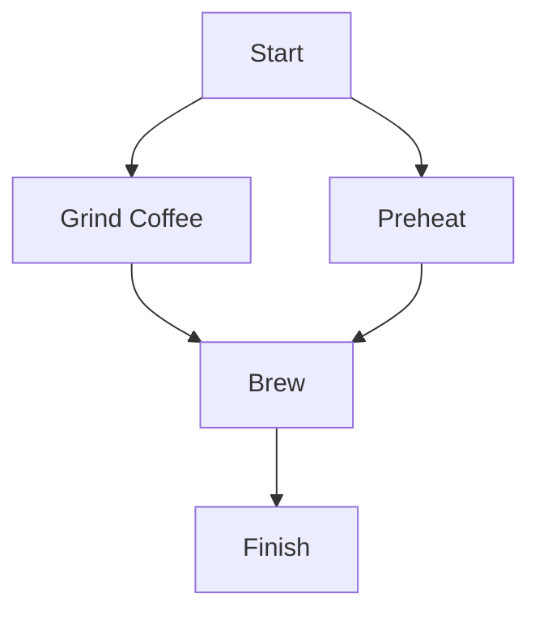

# Creating your first engine

The idea of noRTL is that we create an object for our target hardware component and then use our code to modify it such that it realizes the function we want.
The main entry point for importing the noRTL engine is:

```python
from nortl import Engine
```

In this example, we would like to create a controller for a coffee maker (which is a very productive member in our team). Let's call him Mr. Coffee. (In a later tutorial, we will add Mrs. Espresso).

The coffee making process is to be automated by a machine that has the following components:

* A Start-Button that the user may press to request a coffee
* A Coffee grinder that can be turned on and off for a certain time. Note that we neglect the need for proper grinding settings and weight measurement for focussing on the realization of the logic.
* A Heating unit
* A Water pump

For brewing a coffee, we need to realize the following process.



Before starting to declare ports and function, we need to create our Engine object:

```python
engine = Engine("MrCoffee")
```

The engine name (here: "MrCoffee") needs to be a proper verilog identifier since it will be the module name of our resulting verilog unit.

## Defining inputs and outputs

Now it is time to define the interface of our system. Note that noRTL automatically handles reset and clock pins, so we do not need to include them here.

The engine object provides two functions for declaring ports (function signatures are truncated to keep the explanation simple):

* `define_input(name: str, width: int)`:  Creates an input port for our module with a name and a width of the logic vector.
* `define_output(name: str, width: int, reset_value:int=0)`: Creates an output port with a given width and reset value.

Both functions return signal objects that can be used in the actual logic.

With these functions, we can now define our interface.

```python
start = engine.define_input("START", 1) # The start button
grinder_en = engine.define_output("GRINDER_EN", 1, 0) # Enable/Disable the grinder, disabled by default
heater_en = engine.define_output("HEATER_EN", 1, 0) # Enable/Disable the heater
pump_en = engine.define_output("PUMP_EN", 1, 0) # Enable/Disable the pump
ready = engine.define_output("READY", 1) # Show the user that we are ready to brew the next cup of coffee
```

## Describing the process

The idea of noRTL is that you can describe your process in a more-or-less sequential manner without manually creating states.

For brewing coffee, we need to realize delays in our system to let the grinding process work for some seconds.
Therefore we add a timer to our system assuming that we know our clock frequency.

```python
from nortl import Timer

timer = Timer(engine, 24) # Add a 24 bit timer to our engine
fclk = int(1e6) # 1MHz in our example
```

In case of our Mr. Coffee, the code can look like this:

```python
from nortl import Const

with engine.while_loop(Const(True)): # A forever-loop to restart the process after we finished
    engine.wait_for(start.rising()) # Wait until the user presses the button
    engine.set(ready, 0)
    engine.set(heater_en, 1) # Turn on the heater. Note that we need to use the set-method to write a value to a signal
    engine.set(grinder_en, 1) # Activate the grinder
    timer.wait_delay(fclk*1) # Wait for one second
    engine.set(grinder_en, 0)
    engine.sync() # This realizes a single-cycle delay, we don't want the grinder and the pump to be active at the same time
    engine.set(pump_en, 1)
    timer.wait_delay(fclk*10) # We assume that we need 10s to fill our cup
    engine.set(pump_en, 0)
    engine.set(heater_en, 0)
```

We see the following noRTL constructs in our code:

* `with engine.while_loop(Const(True))`: noRTL realizes the control structures like this loop using context managers. These are constructed to *feel* like their originals.
* `engine.wait_for(<some_event>)`: This creates a transition to a new state with a conditional wait. Once the condition is true (i.e. logic-1), the execution moves on to the next section
* `start.rising()`: A single-bit signal provides the event `.rising()` that internally creates a synchronous edge detector.
* `engine.set(target, value)`: This assigns a new value to a given signal or register. Note that this signal is not placed there instantly but on the next clock cycle.
* `engine.sync()`: Advances to the next clock cycle
* `timer.wait_delay(n_cycles: int)` Waits for a specified number of cycles using the instantiated timer.

## Generating Verilog Code

After we described the logic for our circuit, we need to transfer it to the verilog domain. For this purpose, noRTL realizes so-called renderers.
We can just call a function of the engine, get the verilog code and save it to a file.

```python
with open('MrCoffee.sv', 'w') as fptr:
    fptr.write(engine.to_verilog())
```
