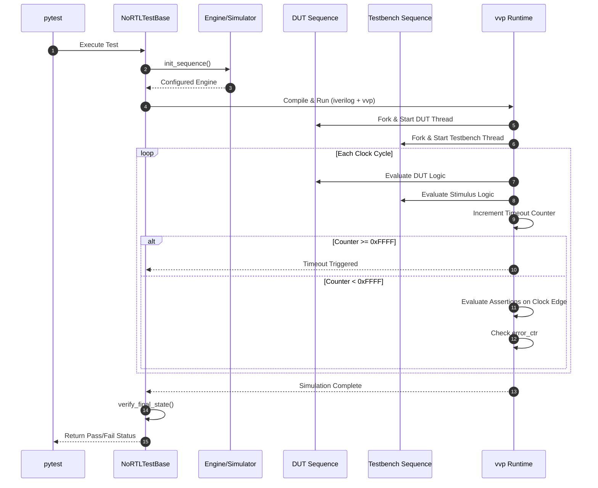

# Testing your Engine with Pytest

As your designs grow, manually checking Verilog output is no longer feasible. noRTL provides a built-in testing framework that automates the generation of Verilog, compilation with Icarus Verilog, and simulation using `vvp`. This allows you to write tests that look like standard Python code but actually run on your simulated hardware.

## The Test Wrapper

To get started, you create a test class that inherits from `NoRTLTestBase`. This base class handles all the heavy lifting: it sets up parallel execution threads, manages timeouts, and runs the simulation pipeline automatically.

Your test class must implement two methods. Two more are optional and default to doing nothing:

1.  **`init_sequence()`** *(required)*: Initializes and configures your engine. This is where you define ports, local signals, and any custom parameters. The engine must be named `"my_engine"`.
2.  **`dut(engine)`** *(required)*: The state sequence describing the hardware you want to test. This runs in parallel to your testbench.
3.  **`the_testbench(engine)`** *(optional)*: The state sequence that acts as your stimulus. This runs in parallel to the DUT and drives inputs to verify behavior.
4.  **`verify_final_state(engine)`** *(optional)*: Another state sequence, emitted while the engine is being built and run during simulation after the DUT and testbench threads have finished, before the pass/fail flag is set. Use `self.assertTrue` and `self.assertEqual` here.

## Parallel Execution and Timeout

In hardware, everything happens in parallel. noRTL's test wrapper reflects this by running your `dut` and `the_testbench` in separate threads using the `Fork` construct. This means you can drive inputs and observe outputs simultaneously, just like in a real circuit.

To prevent infinite loops from hanging your test suite, noRTL includes a built-in **timeout mechanism**. A counter increments every clock cycle, and if it reaches `0xFFFF`, the simulation fails. If your design requires more cycles, you can call `self.reset_timeout()` to clear the counter and keep the simulation alive. For tests that are *intentionally* expected to timeout, set `self.expect_timeout = 1` in `init_sequence()`.




## Assertions

noRTL provides hardware-aware assertions that run *inside* the simulation. They don't just check Python values; they evaluate signals on the clock edge and record failures if conditions aren't met.

*   `self.assertTrue(condition)`: Checks if the condition is true. If false, it prints the failing line of code and increments an error counter.
*   `self.assertEqual(value1, value2)`: Checks if two values are equal. On failure, it prints both values for easy debugging.

Both assertions end with `sync()`, so each one costs a clock cycle of the testbench thread.

If any assertion fails, the hardware error counter increments, and the simulation drives the `passed` flag to `0`. Pytest then fails the test. You can access the error count from within the testbench via `self.engine.signals['error_ctr']` if needed.

## Value Capture

Hardware-aware assertions check conditions *during* the simulation, but sometimes you want to collect values over the full course of the simulation and verify them afterwards in Python. For this, noRTL provides **value capture**: `engine.capture()` records values into a JSONL file during simulation, and the test wrapper parses that file and hands the data to a post-simulation callback.

### Capturing Values

Use `engine.capture(key, *values)` anywhere in your `dut` or `the_testbench` sequence:

```python
def dut(self, engine: Engine) -> None:
    for _ in range(5):
        engine.set(self.counter, self.counter + 1)
        engine.capture('count', self.counter)          # single value
        engine.capture('pair', self.counter, 42)       # multiple values
        engine.sync()
```

Each call emits one JSONL record of the form `{"type": "value", "test": "<test name>", "<key>": [value1, value2, ...]}`. The values are written as a list, so a single-value capture arrives as a one-element list.

### Verifying Captured Values

Override `callback_after_simulation(engine, captured_values)` in your test class. It is invoked after the simulation has finished and the JSONL file has been parsed. `captured_values` is a list of dicts — one dict per `engine.capture()` call, in emission order:

```python
def callback_after_simulation(self, engine: Engine, captured_values: list) -> None:
    assert captured_values == [
        {'count': [1]},
        {'pair': [1, 42]},
        {'count': [2]},
        {'pair': [2, 42]},
        {'count': [3]},
        {'pair': [3, 42]},
        {'count': [4]},
        {'pair': [4, 42]},
        {'count': [5]},
        {'pair': [5, 42]},
    ]
```

Note that `captured_values` contains plain Python data, not engine signals — use regular Python `assert` statements here, not `self.assertTrue`/`self.assertEqual` (which render Verilog assertions for in-simulation checks).

The parsed data is also available as `self.captured_values`, if you need it in `callback_after_execution()`. The raw JSONL file (`self.value_capture_file`) only exists while the simulation run is active.

## Example Test

Here is a complete example demonstrating a test that drives a channel and verifies the DUT's response:

```python
from nortl import Engine
from nortl.utils.test_wrapper import NoRTLTestBase

class MyEngineTest(NoRTLTestBase[Engine]):
    def init_sequence(self) -> Engine:
        engine = Engine("my_engine")  # (1)!

        # Define internal signals
        self.testreg = engine.define_local("testreg", 4, 0)
        self.channel = engine.define_local("channel", 4, 0)

        # Disable access check for parallel read/write in this example
        self.channel.access_checker.disable_check("identical_rw")

        return engine

    def dut(self, engine: Engine) -> None:
        # DUT: Copy channel value to testreg 10 times
        for _ in range(10):
            engine.set(self.testreg, self.channel)
            engine.sync()

    def the_testbench(self, engine: Engine) -> None:
        # Testbench: Drive value 5 onto the channel
        engine.set(self.channel, 5)
        engine.sync()

    def verify_final_state(self, engine: Engine) -> None:
        # Verify that testreg matches the expected value
        self.assertTrue(self.testreg == 5)
        # Alternative: use assertEqual
        self.assertEqual(self.testreg, 5)
```

1. The engine must always be named "my_engine" or else, an `RuntimeError` is thrown.

## Running the Tests

Once your test class is defined, you can run it using `pytest`. The test wrapper automatically hooks into `pytest` via the `test_compile_and_run` method, which:

1.  Calls `init_sequence()` to build the engine.
2.  Generates the Verilog files.
3.  Compiles them using `iverilog`.
4.  Runs the simulation using `vvp`.
5.  Checks the `passed` flag from the simulation output.

If the simulation passes (error counter is `0`), the test succeeds. If it fails, `pytest` will display the simulation output and error details, helping you debug your hardware design efficiently.
