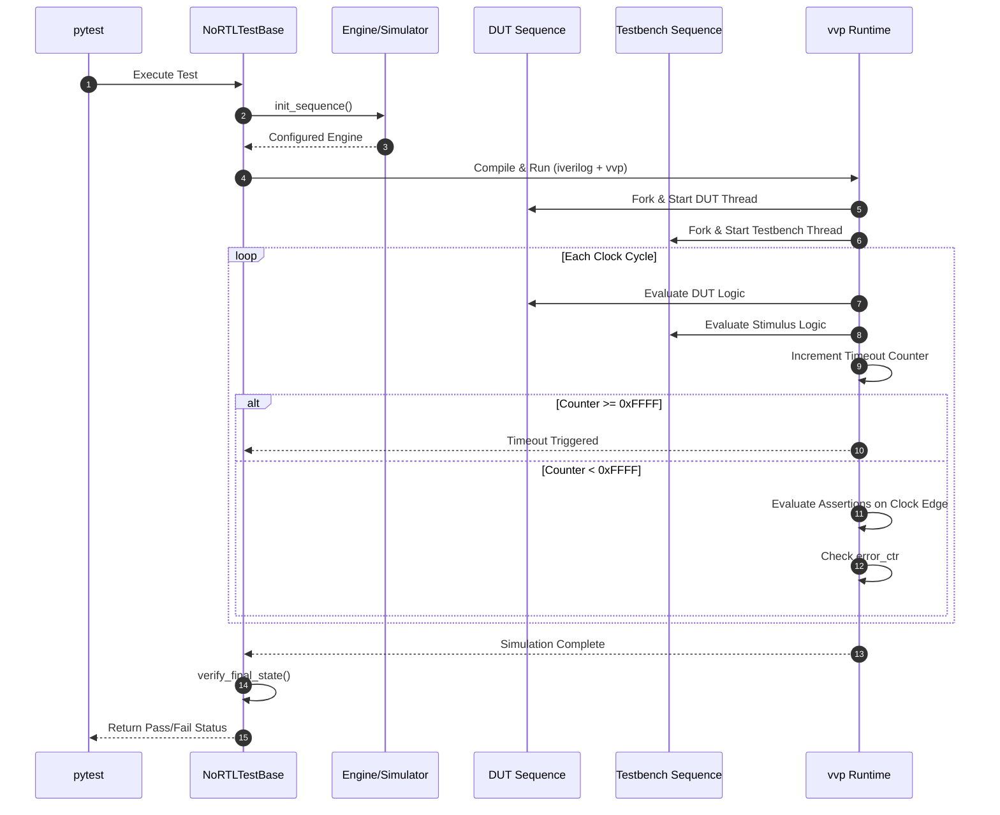

# Testing your Engine with Pytest

As your designs grow, manually checking Verilog output is no longer feasible. noRTL provides a built-in testing framework that automates the generation of Verilog, compilation with Icarus Verilog, and simulation using `vvp`. This allows you to write tests that look like standard Python code but actually run on your simulated hardware.

## The Test Wrapper

To get started, you create a test class that inherits from `NoRTLTestBase`. This base class handles all the heavy lifting: it sets up parallel execution threads, manages timeouts, and runs the simulation pipeline automatically.

Your test class must implement four key methods:

1.  **`init_sequence()`**: Initializes and configures your engine. This is where you define ports, local signals, and any custom parameters.
2.  **`dut(engine)`**: The state sequence describing the hardware you want to test. This runs in parallel to your testbench.
3.  **`the_testbench(engine)`**: The state sequence that acts as your stimulus. This runs in parallel to the DUT and drives inputs to verify behavior.
4.  **`verify_final_state(engine)`** *(optional)*: Called after the simulation ends. You can use this to check final signal values or perform cleanup.

## Parallel Execution and Timeout

In hardware, everything happens in parallel. noRTL's test wrapper reflects this by running your `dut` and `the_testbench` in separate threads using the `Fork` construct. This means you can drive inputs and observe outputs simultaneously, just like in a real circuit.

To prevent infinite loops from hanging your test suite, noRTL includes a built-in **timeout mechanism**. A counter increments every clock cycle, and if it reaches `0xFFFF`, the simulation fails. If your design requires more cycles, you can call `self.reset_timeout()` to clear the counter and keep the simulation alive. For tests that are *intentionally* expected to timeout, set `self.expect_timeout = 1` in `init_sequence()`.




## Assertions

noRTL provides hardware-aware assertions that run *inside* the simulation. They don't just check Python values; they evaluate signals on the clock edge and record failures if conditions aren't met.

*   `self.assertTrue(condition)`: Checks if the condition is true. If false, it prints the failing line of code and increments an error counter.
*   `self.assertEqual(value1, value2)`: Checks if two values are equal. On failure, it prints both values for easy debugging.

If any assertion fails, the error counter increments, and the simulation marks the test as failed. You can access the final error count via `self.engine.signals['error_ctr']` if needed.

## Example Test

Here is a complete example demonstrating a test that drives a channel and verifies the DUT's response:

```python
from nortl import Engine
from nortl.utils.test_wrapper import NoRTLTestBase

class MyEngineTest(NoRTLTestBase[Engine]):
    def init_sequence(self) -> Engine:
        engine = Engine("test_engine")

        # Define internal signals
        self.testreg = engine.define_local("testreg", 4, 0)
        self.channel = engine.define_local("channel", 4, 0)

        # Disable access check for parallel read/write in this example
        self.channel.access_checker.disable_check("identical_rw")

        return engine

    def dut(self, engine: Engine) -> None:
        # DUT: Copy channel value to testreg 10 times
        for _ in range(10):
            engine.set(self.testreg, self.channel)
            engine.sync()

    def the_testbench(self, engine: Engine) -> None:
        # Testbench: Drive value 5 onto the channel
        engine.set(self.channel, 5)
        engine.sync()

    def verify_final_state(self, engine: Engine) -> None:
        # Verify that testreg matches the expected value
        self.assertTrue(self.testreg == 5)
        # Alternative: use assertEqual
        self.assertEqual(self.testreg, 5)
```

## Running the Tests

Once your test class is defined, you can run it using `pytest`. The test wrapper automatically hooks into `pytest` via the `test_compile_and_run` method, which:

1.  Calls `init_sequence()` to build the engine.
2.  Generates the Verilog files.
3.  Compiles them using `iverilog`.
4.  Runs the simulation using `vvp`.
5.  Checks the `passed` flag from the simulation output.

If the simulation passes (error counter is `0`), the test succeeds. If it fails, `pytest` will display the simulation output and error details, helping you debug your hardware design efficiently.
